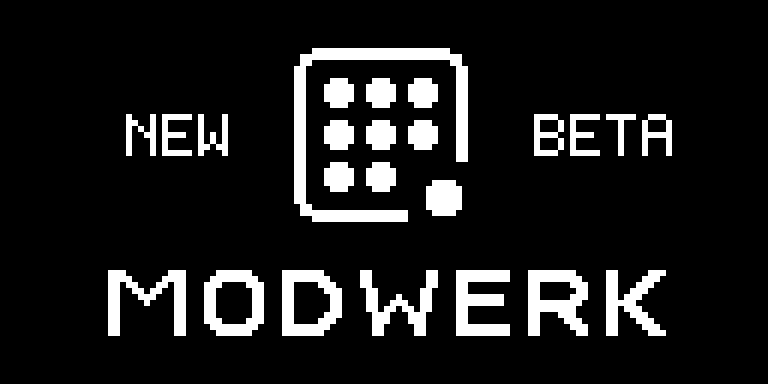

# Modwerk Octatrack startup — 8 October 2026

## Beta docking edition — 12 October 2026

New Octatrack builds for beta testers and verified administrators include the
Elekloader migration's docking startup, ported independently of its new base.
The mark flies in, a module crosses the lamps and docks, and its wave reveals
MODWERK with **NEW / BETA**. It lasts 3.5 seconds. Ordinary members keep the existing
2.8-second startup. Existing firmware files need to be rebuilt to receive it.

Beta eligibility is carried through validation, composition, alternative placement
checks and standalone MIDI Scenes. The server rechecks beta access immediately
before a beta build; revocation also changes the frontend build key. The build
panel labels the beta startup, and its source/configuration fingerprints distinguish
it in the device logger.

The port changes the startup loop and compositor frame-load sites and adds its
authored runtime object and persistent ROM cave gate. Both sites have SHA-256
guards; original frame-load code
comes from the verified local firmware. The drawing adapter preserves registers
and flags and stops drawing after startup. Both models restore the stock panel
colours. The same sample-memory reservation is used; the extra initialized runtime
state remains inside the existing runtime/staging bounds. The gate and its
initially zero active word occupy 80 bytes reserved before beta descriptor clones;
utility overflow sites stay intact.
Standalone MIDI Scenes uses the unused fill after its scene-mute helper. Early
compositor calls replay the stock instruction before the runtime is unpacked;
the appended loader area is reused by stock RAM and cannot hold this gate.

The original migration's MKII RAM-boot observation on 11 October applies to that
base, not to this port. Physical flashing, reboot and timing of this beta port
remain untested. The emulator exercised core-only and standalone MIDI Scenes on
both MKI and MKII. All four runs matched all 912 authored final pixels, lit the
expected 44/67 lamps on the correct channel with bounded levels, ended dark,
and handed over to the stock screen with identical LED levels, rows and colours.

The native matrix passed for core only, Repitch, Mini Verb, Tape Echo + Euclid,
Analog BD, Sidechain Compressor, USB Audio + Quantizer, standalone MIDI Scenes,
Airwindows Chorus and Poly8; the developer dynamic-loader Repitch path passed
as well. With Node 24, the full app/SDK/lint/typecheck/bundle suite passed
all 1,748 tests in 233 files. GNU/browser startup links matched at both runtime bases, and the ROM
gate matched GNU placement. Every final image round-tripped through the original
firmware container without changing its tail or seed. Changed hooks and repeated
patching were rejected. The standalone live CC-cache table remained intact.



[Native composition evidence](media/startup/beta-docking-native.json),
[core boot captures](media/startup/beta-docking-core.json) and
[standalone boot captures](media/startup/beta-docking-midi-scenes.json) contain
hashes and results only. Firmware and raw memory remain private.

Source, package regeneration and private-check commands are in the
[startup SDK](../sdk/runtime/startup/README.md#beta-docking-edition).

## Public graphic-table edition

The boot animation now traces the Modwerk frame clockwise, locks eight tiles
in from the center around the ring, and brings the ninth tile in with a short
comet tail. It reveals original geometric MODWERK lettering alongside the
assembly. The stock monochrome treatment, 2.8-second duration and both models'
LED choreography remain in place. The extra choreography uses the same 843
records; it adds no firmware bytes.


The preview uses complete frames read from the real firmware LCD plane. Its
final 600 ms hold is for reviewing the image; firmware timing is unchanged.
[Capture provenance](media/startup/capture.json) records the exact local image,
emulator and asset hashes. [Verification records](media/startup/verification.json)
bind the current sources and graphic bytes to the checks below. No firmware or
raw memory is published.

## Scope

Two original graphic tables are replaced: 5,058 bytes of particle records and
440 bytes of title ink. Boot, LCD renderer, LED and module instructions remain
byte-identical. Table extents and particle count are unchanged, with no added
flash/RAM allocation or sample-memory reservation. The startup artwork is
installed in static compositions, standalone MIDI Scenes, and the developer
dynamic-loader composition path. Both writes are guarded and checked before
any mutation.

See [the source and native encoder](../sdk/runtime/startup/README.md) and
`scripts/verify-startup-animation-native.mjs` for reproduction instructions.

## Passed checks

- Ten complete images matched the independent Python encoder byte for byte:
  core only, Repitch, Mini Verb, Tape Echo + Euclid, Analog BD, Sidechain
  Compressor, USB Audio + Quantizer, standalone MIDI Scenes, dynamic-loader
  Mini Verb, and direct static core composition with stock FX2.
- Against private complete-image baselines captured before the change, all ten
  final images had exactly the same length and identical bytes outside the
  two graphic tables, including every appended runtime byte.
- Both encoders rejected changed graphic tables; the browser rejected a
  repeated patch. Native guard failures created no partial output. Original
  inputs remained unchanged. Static graphics spans were disjoint from all
  other module/platform/logger writes in the tested profiles.
- All ten final images round-tripped through full firmware packaging with
  the owner's original local 1.40C container.
  Decoded MAIN bytes matched exactly; opaque tail and seed were preserved and
  the original firmware input remained unchanged.
- The standard emulator ran the full boot on MKI (core-only composition) and
  MKII (standalone MIDI Scenes) and reached normal playback after the animation.
  Complete-frame capture then recorded 70 MKI and 69 MKII frames. Both final
  LCD frames exactly matched all authored pixels, with identical PNG hashes.
- Twenty focused engine tests passed, including artwork extent/orientation,
  final silhouette, bounded delays, clockwise tile order and the late ninth
  tile/echo timing.
  On the focused PR checkout based on current `main`, all 1,191 repository
  tests in 180 files passed. ESLint, the full TypeScript check, SDK checks,
  generated-record checks and the production Vite bundle passed using
  Node 24.21.0 (`npm run check -- --base origin/main`).

## Limits

Physical startup/reboot and chip wall-clock timing remain untested. No loaded
project, Part save/reload, project save/load or restart retaining only card and
battery-backed RAM was exercised here. A boot to playback without a loaded
project does not establish any of those paths. The byte comparisons show that
this patch leaves module/runtime bytes intact; they do not upgrade earlier
stateful-module qualification or physical reports.

No hardware flashing or module qualification-status change was performed.

## Base edition: docking (11 October 2026)

The Elekloader base starts with its own animation, so beta testers see at once that
the new base is running. The mark's ninth dot is a module arriving, which is what
this base does. First the mark flies in: every pixel of the frame and the tiles comes
from far beyond the screen and lands, as in the stock logo's flight, while the lamps stay
dark. The empty corner, the socket, blinks, and a light far off at trig 1 answers. The module
runs along the trig row, turns up through the keys under the screen and docks with a
shudder of the screen's rows. Its wave bends the screen as it passes (a lens: up to
3 px outwards within 7 px of the ring, with a solid ring and a dotted echo on top),
reveals MODWERK, **NEW** and the version (`0.3.1`, from `VERSION` in
`build_core.py`) and rolls on across the panel. It takes 3.5 s, 0.7 s longer than
stock. The base draws its own compact art from `base.json`, with room between the
elements: the mark at 29 px (5 px tiles), MODWERK at 11 px tall, and NEW and the
version in the panel's small 7 px type. Public builds are unchanged.


Screen and lamps are one plane, so the module and the wave cross the screen's edge
without a break; the lamps show nothing else, so the module's run and the wave stand
out. The lamps are white on an MKII, at the panel's LED intensity, and
red on an MKI, which has fixed colours. Afterwards the MKII gets its stock colours
back: the startup repeats the firmware's own pre-logo colour call (`0x4003f430` with
the lamp lists only), and the firmware's own post-logo call follows as usual.

How it is built: `build_core.py` puts a jump on the first instruction of the stock
logo loop (0x400559c6) to `boot_anim.s`, which calls the C startup and continues with
the stock code after the loop (0x40055b7e). That code resets every LED itself.
`boot_anim.c` keeps the stock loop's own means: the free-running DTIM3 count for
time, the stock compositor and LED routines, and the frame through the core's
`ev_draw` hook. The art comes from `artwork.json` and `base.json` through
`sdk/runtime/startup/base_art.py`. Lamp positions come from the stock lamp table at
run time. The LCD's place on the MKII panel was measured against the panel drawing;
on the MKI it is an estimate.

[Verification record](media/startup/base-verification.json).
`scripts/verify-startup-base.py` boots the real base image (built with
`build_core.py`, checked with `check_flash_safety.py`) and the stock image in the
emulator with the boot logo on:

| Check | MKI | MKII |
| --- | --- | --- |
| Last startup frame vs. authored pixels (mark, wordmark, NEW, version) | 887 of 887, 0 missing, 0 extra | 887 of 887, 0 missing, 0 extra |
| LEDs: one channel, levels 0-15, dark before the stock code takes over | yes; all 44 lamps take part | yes; all 67 lamps take part, white |
| Hand-over; LED rows, levels and colours afterwards as stock | yes, identical | yes, identical |

The checker rejects the public image. A host test (`test_boot_anim.c`, run by
`test_recipe.py` in CI) plays the startup on a simulated clock as an MKII and an MKI.
It checks the exact final frame, writes only inside the frame, one LED channel, each
beat on the lamps, all dark at the end, and the white and restore calls on an MKII
only.

Cost per frame, as executed instructions in the emulator (MKII, counted between
hits of the frame's draw entry, against the stock loop's head): the startup runs a
median of 56k instructions per frame (90th percentile 93k), the stock logo loop 95k
(90th percentile 299k, max 331k). The frames in which the wave bends the screen, about
400 ms, run 520k-565k (a square root and two divisions per pixel in the band), and the
setup frame 664k: roughly twice the stock loop's worst, a few milliseconds of CPU.
These are instruction counts, not cycles or hardware timing; divisions cost more
cycles than most instructions.

On hardware, 11 October 2026: the owner's MKII RAM-booted a base with this startup
(`de124ebd8a069763…`, built from `b4e0584f` with `--dev --dsp-loader`, 1,305,168 bytes of
MAIN, under the gate's 1,310,720), came back to the normal screen with its project
loaded, and the owner watched the startup and reports that everything worked. That is
the owner's observation of one boot; no frame rate or brightness was measured. An MKI
has not run it, and its LCD position is still an estimate. The browser builder does not compose the base, so only `build_core.py`
has this startup.

## Firmware name before the animation

Updates now use **ELEKLOADER** in the fixed ten-byte ELEK name field, including
standalone MIDI Scenes. The original panel boot font uses uppercase letter
codes; lowercase codes select symbols, patterns and filled blocks. The first
follow-up used `Elekloader`: its header was correct, but its glyphs were wrong.
The owner reported the malformed text on their device. This correction keeps
the same ten cells, with no extra firmware space or runtime changes.

The headless emulator ran the **original MKII panel character-drawing routine**
for the previous `OCTAMOD79 `, the broken `Elekloader`, and corrected
`ELEKLOADER`. Each of the 30 original calls returned. The captures below decode
the routine's actual LCD controller command/data writes, with all 80 columns
per name matched against the original local panel font. They are crops of the
ten observed name cells, enlarged at integer scale 8; no text is reconstructed.

Broken lowercase name:


Corrected uppercase name:


[Renderer and packaging verification](media/startup/boot-name-renderer-verification.json)
records the exact MAIN, emulator, panel and capture hashes. Reproduce on a host
where the reviewed local emulator runs:

```sh
python3 scripts/verify-boot-name-renderer.py \
  --image /private/path/decoded-MAIN.os \
  --emulator /private/path/ot_emu \
  --output /private/path/new-capture-directory
```

The checker uses a new empty disposable FAT16 card. It runs the unchanged
embedded panel instructions through the headless emulator's function-call
path, maps the original local font at the panel's own absolute address, seeds
the resident loader's page/cell cursor, and records the GPIO/LCD writes.
Firmware, font tables, card and raw logs remain private. The new checker needs
no Unicorn installation and does not change emulator or firmware instructions.

This is a **panel-renderer function capture**, not a complete resident-loader
boot. Standard Octemu/headless MAIN boot skips the resident loader, and Octemu
currently ignores its character protocol. MKI panel firmware/font is absent
from MAIN and was not emulated; the new physical rendering is still untested.
These limits do not negate the reproduced MKII lowercase glyph failure.

Native Python ELUP output matches browser packaging byte for byte for FM Synth,
standalone MIDI Scenes and dynamic-loader Mini Verb. Every MAIN hash still
matches its previously tested startup image; original inputs, opaque tail and
seed remain intact. Against the saved visitor baseline, the complete ELEK
container differs only in the ten name bytes. OS/runtime/DSP instructions,
artwork, extents and memory reservations remain unchanged.

Session regression tests cover validation/build reports and all ten header
bytes for Repitch, MIDI Scenes and USB Audio + Quantizer with both stock-FX2
choices. A separate letter-range assertion rejects accidental lowercase
branding. Individual module versions remain separate. The earlier
[header-only proof](media/startup/boot-name-verification.json) retains its
original names and hashes as historical packaging evidence, not glyph evidence.
