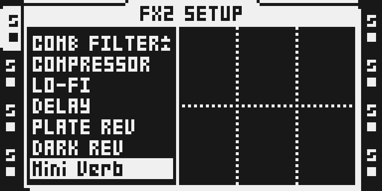
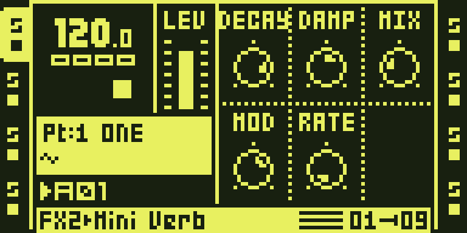

# Mini Verb

Version: 0.2.1-experimental · author: [Jannik Aßfalg](https://github.com/repeat98)

## Overview

Mini Verb is a four-branch, eight-allpass reverb with stereo output tone and
modulation. This update fixes intermediate dry/wet clipping at hot input
levels: the mixer preserves headroom for the wet-minus-dry difference before
multiplication, then limits only its final output. The tank, controls, defaults,
FX ID 0x17 and state allocation are unchanged.

The mixer defect is reproduced on both native emulated DSP cores. The original
THRU noise reported in [#428](https://github.com/repeat98/modwerk/issues/428)
remains unconfirmed on hardware. The owner approved this exact experimental source with hardware, chip timing
and complete runtime memory bounds waived on 11 October 2026. Report #428
stays open until reporter confirmation; see TESTING.md for the evidence and limits.

## Controls

The main FX2 page is:

| Encoder | Upper row | Default | Encoder | Lower row | Default |
| --- | --- | ---: | --- | --- | ---: |
| A | DECAY | 104 | D | MOD | 80 |
| B | DAMP | 70 | E | RATE | 2 |
| C | TONE | 64 | F | MIX | 40 |

- DECAY sets tank feedback from 0.65 to below 0.968; room geometry is fixed.
- DAMP darkens the recirculating tail as it decays. Its existing behavior stays unchanged.
- TONE colors only the wet output: 0 is dark, 64 is exactly neutral, 127 is bright.
- MOD controls the smoothed depth of two interpolated in-loop allpasses, up to about 64 samples.
- RATE selects eight existing modulation speeds, approximately 0.34–2.69 Hz.
- MIX is 0 for exact dry and 127 for fully wet, with the existing smoothing.

The setup page has no additional controls. Tone uses one first-order filter
per stereo channel and four new scalar words in the existing instance block;
no additional delay allocation, global writable state or filter inside the
feedback tank. Dark uses a 1/16-coefficient low-pass; bright subtracts the same low-pass
to produce its complementary high-pass. Their shared crossover is about
453 Hz at 44.1 kHz. Intermediate values blend toward the neutral voice
without boosting a band. Bright removes bass rather than adding treble gain.

Tone smooths per sample with a 1/256 coefficient. The crossover stays fixed during movement, and an exact neutral bypass
retains the tank's neutral output and reduces its instruction cost.
A sub-LSB remainder snaps to its target once per process call, outside the
sample loop, so returning to 64 reaches an exact bypass. Both stereo
filter histories clear with the existing unconditional instance initialization.

## Usage

Select Mini Verb in an audio track’s FX2 slot, then start with Tone at 64 and Mix at 40.

### Quick tutorial

1. Select an audio track, hold FUNC and press FX2, then choose Mini Verb with LEVEL and YES.
2. Press FX2, turn encoder F (MIX) to 127, and compare encoder C (TONE) at 0, 64 and 127 while playing a sample.
3. Lower MIX to place the colored reverb behind the dry signal; set MIX to 0 to hear the exact dry signal and bypass the wet output.

Use DAMP to set how quickly the tail loses high frequencies, then use Tone to
place the whole wet signal in the mix. Tone does not alter the tank feedback,
room lengths, modulation clock or existing DECAY/DAMP/MOD/RATE mappings.

## Compatibility and limitations

FX2, Octatrack OS 1.40C; own effect ID 0x17 beside DARK REV. No parameter or
project-layout migration is needed from 0.2.0. The wider mixer can change
otherwise unclipped output by up to 8 of the 24-bit least significant bits;
neutral audio is no longer promised bit-identical to older mixers.
Physical hardware, chip timing, complete runtime bounds, played automation,
Part/project persistence and physical reboot remain unverified for this source.
Review the migration below when upgrading from 0.1.x.

**Existing project data needs migration.** Parameters are stored by slot, not
name. Slot C previously held MIX and now holds TONE; slot F previously had no
control and now holds MIX. Restore TONE to 64, copy the previous Mix value to F
in every affected Part, and move Mix parameter locks, scene assignments and LFO
destinations from C to F. Slot C values from an old project are not a valid Mix
setting in this release. Back up the original project before changing it. The
FX ID stays the same, so old projects still select Mini Verb but cannot
implicitly migrate these parameter bytes. Downgrading requires the reverse
mapping and removal of Tone automation.

The four original controls retain their slots, ranges and defaults. Both new
and moved continuous controls must still be checked with parameter locks,
scenes, crossfader and LFOs on an actual unit. Physical reboot and usable audio
after Part/project reload have not been verified for this source.

## Tests and measurements

[TESTING.md](TESTING.md) records native DSP regressions, native/browser
composition parity, LCD captures, conservative software bounds and the
remaining hardware limits. [verify.py](verify.py)
assembles with the existing common native assembler and its disassembly audit,
then runs the existing DSP host against the developer's private stock payloads.
It does not substitute for native/browser composition parity or chip timing.

The 16K ring allocation and its occupied 13,750 positions are unchanged.
Tone adds target/current state at X:(r7+$2e/$2f) and left/right pole history at
X:(r7+$3c/$3d), within the original X:(r7+$20..$3f) block. Initialization still
clears all 32 scalar words and progressively clears the same 16K ring.
The mixer adds four program words and four instructions per stereo sample,
with no additional scalar or ring state. Historical cost and hardware records
remain version-labelled; they are not tests of this update.

## Authorship and licences

Original Mini Verb by Jannik Aßfalg; octabam by Sam Banks, with component
credits in [the SDK attribution](../../octabam/THIRD_PARTY.md).
Source remains under the original [MIT licence](LICENSE). This change adds
no stock firmware, code tables or proprietary assets to the repository.

## Screens and audio

Actual firmware-rendered LCD captures from the private common-builder image:

These emulator captures show the six-control layout with transport stopped and an
empty scratch card; they do not prove hardware behavior or audible playback.
See [capture provenance](media/capture.json) and [capture rights](media/LICENSE.md).
The native verifier writes private dark/neutral/bright percussion WAVs for
level-preserving listening. Physical hardware remains untested for this source.

**Audio preview.** [Listen](media/audio-preview.mp3). One clap, played three times: dry, then Mini Verb as a room (DECAY 104, DAMP 70, TONE 64, MOD 80, RATE 2, MIX 76), then a long, bright tail (DECAY 122, DAMP 40, TONE 96, MOD 110, RATE 5, MIX 90). It is an offline render on a computer through version 0.2.0-experimental, not a recording of an Octatrack or a test of the 0.2.1 mixer fix. The sample, settings and method are in [audio-preview.json](media/audio-preview.json); rights are in [media rights](media/LICENSE.md).
