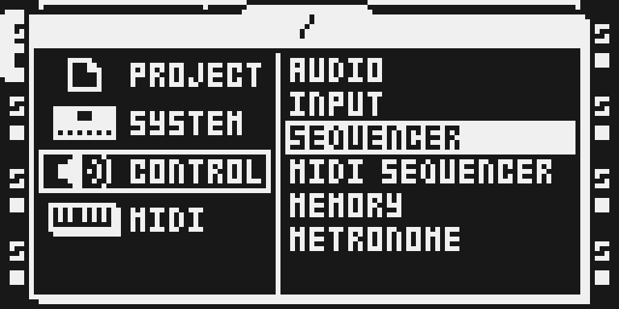
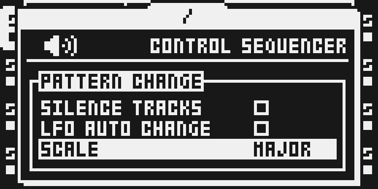
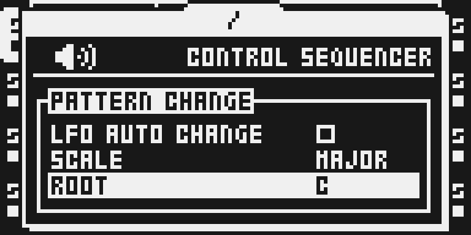
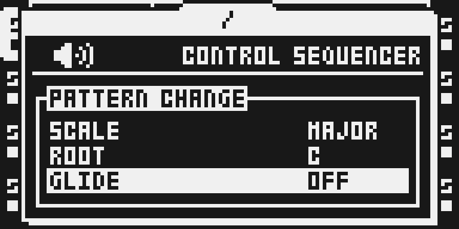
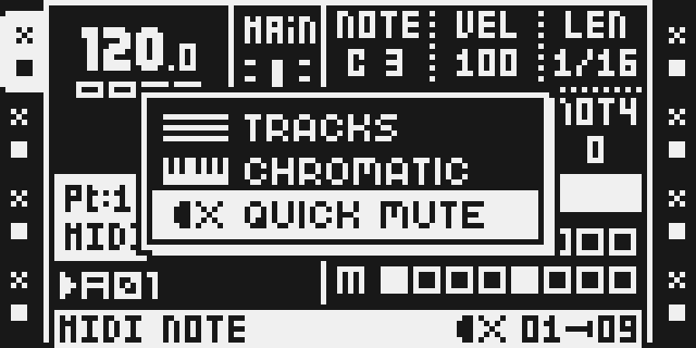

# Scale Quantizer

Version: `0.1.3-experimental`, for Octatrack OS 1.40C.

## Overview

Scale Quantizer adds SCALE, ROOT and GLIDE to PROJECT > CONTROL > SEQUENCER.
Pitch edits, parameter locks and chromatic audio trig keys follow the selected
scale and root. Version 0.1.3 repairs the standalone Quantizer MIDI trig-mode
popup freeze reported in [#181](https://github.com/repeat98/modwerk/issues/181).

## Controls

- **SCALE:** OFF or one of 24 scales. OFF restores stock pitch behavior.
- **ROOT:** C–B. Transposes the selected scale and audio chromatic keyboard;
  ignored with SCALE OFF.
- **GLIDE:** OFF or 1–127. Slide time depends on the track's LEG setting.
  Synth-specific glide and polyphony require the separate FM Synth module.

## Usage

Use PTCH on a Flex, Static or Pickup audio track to step through scale degrees.
Parameter locks and chromatic trig keys use the same root-rotated scale.
SCALE, ROOT and GLIDE are shared project settings. The source stores them in
battery-backed RAM and project save lines; current-build physical reboot and
save/reload behavior have not been tested.

### Quick tutorial: choose a scale

1. Open PROJECT > CONTROL > SEQUENCER and scroll to SCALE. Turn LEVEL to select MAJOR; OFF restores stock pitch behavior.
2. Scroll to ROOT and turn LEVEL to choose C. ROOT transposes the selected scale and the audio chromatic keyboard.
3. Close the project menu, select a Flex or Static audio track with a sample assigned, and turn PTCH or play the chromatic trig keys. Notes follow the selected scale.
4. Switch to MIDI mode. Hold FUNC and press DOWN or UP to change trig mode; release FUNC to leave the popup. MIDI octave numbers retain the stock format.

## Compatibility and limitations

The module adds ColdFire control hooks and no continuous DSP audio engine.
RATE is not a semitone control. FM Synth carries its own signature-aware
Quantizer; the reviewed POLY8 composition uses that bundled implementation
when both are selected. POLY8 owns its own keyboard hooks. This release
changes the standalone Quantizer and its composition declaration, and leaves
the POLY8 and FM Synth executable source unchanged.

The MIDI popup regression is an emulator result. Current-source audio,
physical hardware, Part/project persistence, power-cycle survival, chip timing
and complete memory bounds remain untested. Historical hardware results apply
to earlier source only. See [TESTING.md](TESTING.md) for exact evidence and limits.

## Tests and measurements

The old standalone build reaches an illegal-instruction stop when MIDI mode's
FUNC+DOWN popup is held through a redraw. The repaired build passes that same
plan on MKI and MKII emulated panels. Stock firmware and current FM Synth are
controls. Native/browser composition identities and rejection coverage are
recorded separately in [TESTING.md](TESTING.md).

The upstream record lists a 243-byte ROM core/stub/trampoline footprint;
DRAM code, menus and loader overhead are additional. Relative CPU, DSP and
memory gauges are source estimates. They do not measure whole-device headroom.
No current-build physical hardware or chip-cycle measurements are claimed.

## Authorship and licences

Tim Hastie authored Scale Quantizer in
[timhastie/octatrick-modules](https://github.com/timhastie/octatrick-modules),
pinned here to v2.9 (`525f4b19b04dc3ba3f3bae3b25abbf48df34a10a`). Sam Banks
provided the Octabam wrapper, pinned to
`363861e31ee963c478fab2b190a0fabe1d7ce37b`. The local MIDI-safe drawer change
follows the reviewed fix already carried by FM Synth. Vendored source remains
MIT licensed with its original notices in [LICENSE](LICENSE) and
[upstream/LICENSE](upstream/LICENSE). The wrapper executes the locally vendored
manifest; local fixes are recorded in the version-matched release notes.

Original framebuffer captures use
[LicenseRef-OT-UI-Documentation](media/LICENSE.md). Underlying Elektron interface
rights remain reserved. No firmware or extracted stock image is distributed.

## Screens and audio

These are actual emulator-rendered LCD captures of this version, with stopped
transport and an empty disposable card. They document the interface only.
[Capture provenance](media/capture.json) records the exact local image, emulator,
panel plan and PNG hashes. No audio preview or hardware audio evidence is supplied.

